# Catálogo de formatos de portada

Referencia visual y editorial de la portada [`/`](./README.md#rutas-actuales),
aprobada por el directorio en mobile y desktop (corte visual en 1024 px). Sus
reglas para los futuros editores y el proveedor del CMS son **acuerdos
editoriales existentes para una etapa posterior**: el CMS aún no está
implementado ni se define aquí su tecnología o interfaz interna. Los nombres
identifican formas de presentar contenido, no secciones del diario ni
componentes de React. Los textos, fotografías y anuncios actuales son muestras,
salvo las fuentes externas indicadas.

> **Capturas:** tomadas de la portada `/` en el Chrome compartido el 2026-10-26, a 414 px y 1440 px. Cada imagen enlaza su versión de resolución completa. Los reproductores y widgets externos reflejan el estado disponible al capturar; un panel sin imagen no es una especificación de su contenido. Las vistas de «Gráfico + chat» y «Espacio de juegos» se actualizaron tras separar ambos formatos.

## Cómo usar este catálogo

- **Formato:** plantilla visual con un ID estable, cupos y reglas de presentación. Ejemplo: `principal-cuatro`.
- **Tema:** rótulo y enfoque editorial. «Política», «Sociedad», «Crimen» y una futura «Economía» pueden usar el mismo formato.
- **Instancia:** aparición concreta de un formato en la home. Tiene identidad, posición, título, selección de contenidos y configuración de fuente propios. Dos instancias de `principal-cuatro` son independientes.

El **ID de formato** es el identificador conceptual que usarán editores y proveedor para hablar de la misma plantilla; no equivale a los atributos `data-home-module` del prototipo. El catálogo no prescribe modelo de datos, API, interfaz de CMS ni framework. La maqueta actual muestra una composición fija: la capacidad editorial descrita abajo es un **contrato para la futura implementación**, no una función disponible hoy.

El editor debe poder agregar **más de una instancia de cualquier formato** y ordenar libremente los bloques de primer nivel. Los formatos compuestos se mueven como **una unidad** y conservan el orden de sus partes; no se reordenan sus piezas internas ni se sustituyen por otros formatos. Cada nueva instancia requiere identidad y contenido propios: duplicar un formato no copia automáticamente noticias, videos, encuestas, anuncios ni fuentes. La selección de fuentes puede ser manual o alimentada por una integración, pero debe quedar definida para esa instancia. Si faltan datos para una presentación coherente, la implementación debe omitirla sin dejar un bloque vacío permanente, siguiendo la degradación del prototipo.

**Cabecera editorial es una composición cerrada.** En desktop mantiene Apertura y Principales a la izquierda y un lateral a la derecha; en mobile mantiene Apertura, Última hora Agencia y Principales en ese orden. «Principal + cuatro» es siempre de **ancho completo** y no tiene variante de ocho columnas para entrar en la cabecera. La cabecera completa puede cambiar de posición respecto de otros bloques, pero sus piezas y su orden interno permanecen fijos. Repetirla en el CMS futuro implicaría una cabecera independiente con sus propios contenidos, no reutilizar los de la primera.

### Índice rápido

| ID estable | Nombre para el editor | Ejemplo en `/` | Cupo o estructura |
|---|---|---|---|
| `cobertura-video` | Cobertura con video | Muy Destacada | 1 cobertura + 2 relacionadas |
| `cabecera-editorial` | Cabecera editorial | Apertura, Principales y lateral | 1 apertura + 6 principales + actualidad y participación |
| `principal-cuatro` | Principal + cuatro | Política, Sociedad, Crimen | 1 principal + 4 secundarias |
| `retratos` | Retratos | Gente | 6 perfiles |
| `firmas` | Firmas | Opinión | 4 columnas |
| `panel-deportivo` | Panel deportivo | Ovación | 1 agenda + 1 principal + 4 secundarias |
| `ultimas-noticias` | Últimas noticias | ULTIMATEM | 10 noticias |
| `videos-mam` | Videos MAM | MAM | feed; 15 previews desktop |
| `videos-shorts` | Videos Shorts | Shorts | feed de hasta 12; 6 a la vista desktop |
| `videos-branded` | Videos Branded | # A COMER! | feed de hasta 10; 6 a la vista desktop |
| `participacion-analisis` | Participación y análisis | Encuesta + Senatus | 1 encuesta de 4 opciones + 2 notas |
| `transmisiones-anuncio` | Transmisiones y anuncio | Canal 7 + Radio Nihuil + publicidad | 2 transmisiones + 1 anuncio |
| `grafico-chat` | Gráfico + chat | Gráfico interactivo + Chat Vox Dei | 1 gráfico responsive + 1 chat |
| `publicidad-adaptable` | Publicidad adaptable | Anuncio tras Ovación | 1 creatividad por contexto |
| `espacio-juegos` | Espacio de juegos | Sudoku mobile / reserva desktop tras Crimen | 1 espacio de juegos |

### Fichas

#### Cobertura con video · `cobertura-video`

**Capturas de `/` (414 px y 1440 px):**

| Mobile | Desktop |
|---|---|
| [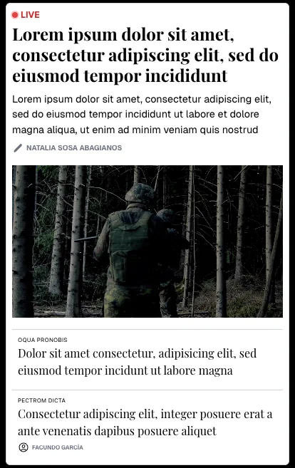](./docs/formatos/cobertura-video-mobile.webp) | [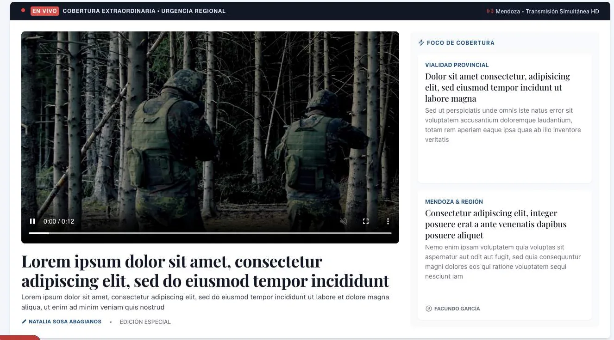](./docs/formatos/cobertura-video-desktop.webp) |

- **Cupos y campos:** una cobertura con estado «en vivo», título, bajada, autor, URL de video y dos notas relacionadas con categoría y título; las relacionadas admiten bajada y firma.
- **Fuente actual:** video de muestra de Pexels; textos editoriales de maqueta.
- **Responsive e interacción:** mobile apila la cobertura y las relacionadas; desktop distribuye protagonista y foco de cobertura. El video tiene controles nativos, autoplay silenciado y loop. Las pistas de hover son visuales; no se debe inferir una navegación de las cards que hoy no existe.
- **Uso editorial:** una cobertura extraordinaria sobre una emergencia regional, con dos notas que amplían el hecho.

#### Cabecera editorial · `cabecera-editorial`

**Capturas de `/` (414 px y 1440 px):**

| Mobile | Desktop |
|---|---|
| [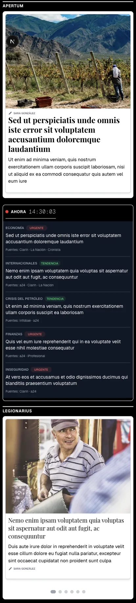](./docs/formatos/cabecera-editorial-mobile.webp) | [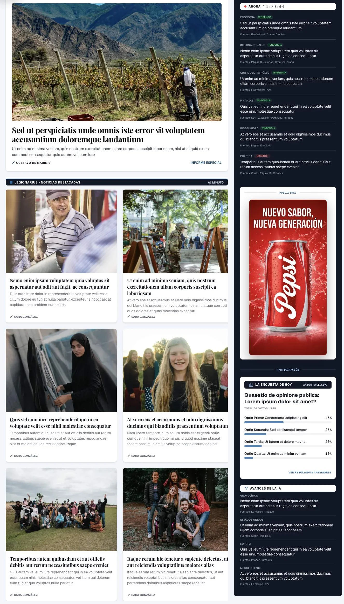](./docs/formatos/cabecera-editorial-desktop.webp) |

- **Cupos y campos:** una Apertura con foto, título, bajada y firma; seis Principales con foto, título y metadatos editoriales; cinco noticias de Última hora Agencia en mobile. El lateral desktop reúne **AHORA** con seis titulares, anuncio 300×600, una encuesta de cuatro opciones y **AVANCES DE LA IA** con cuatro titulares. Cada noticia de actualidad necesita al menos título y resumen; se conserva su origen y marca temporal cuando corresponda.
- **Fuente actual:** fotos y copys editoriales de muestra; noticias de AHORA/Agencia y avances IA preparados en el prototipo; anuncio Pepsi local; encuesta de muestra. El lateral no toma los seis principales como fuente automática.
- **Responsive e interacción:** desde 1024 px ocupa una grilla 8/4: Apertura encima de Principales en las ocho columnas izquierdas, lateral completo en cuatro columnas a la derecha. Mobile muestra Apertura, Agencia y luego Principales; Principales es carrusel allí y grilla 2×3 en desktop. Los títulos de Agencia, AHORA e IA abren y cierran resúmenes; se conserva teclado, Escape y retorno de foco. La encuesta actual muestra resultados visuales, sin votación persistente.
- **Uso editorial:** apertura del día, seis lecturas prioritarias y un lateral de actualidad. Su composición interna es fija incluso cuando la cabecera se mueve en el orden de la home.

#### Principal + cuatro · `principal-cuatro`

**Capturas de `/` (414 px y 1440 px):**

| Mobile | Desktop |
|---|---|
| [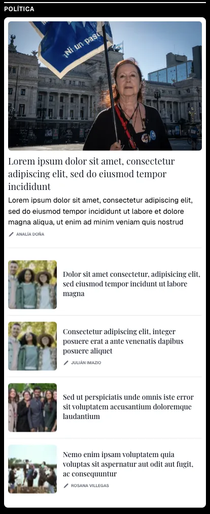](./docs/formatos/principal-cuatro-mobile.webp) | [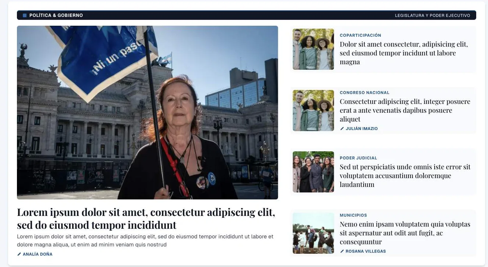](./docs/formatos/principal-cuatro-desktop.webp) |

- **Cupos y campos:** título de sección, posible subtítulo, tono de acento, una nota principal con foto horizontal, título, bajada y firma; cuatro notas secundarias con foto, categoría y título, con firma cuando aplique. Cada nota debe tener referencia editorial propia.
- **Fuente actual:** noticias y copys de muestra, fotos Pexels con selección editorial local. Política, Sociedad y Crimen comparten la estructura visual; difieren en rótulos, contenido y acento (Crimen usa rojo).
- **Responsive e interacción:** mobile apila principal y cuatro filas; desktop usa el **ancho completo** con panel y grilla 7/5 interna. Las cards muestran tratamiento de hover; solo enlazar donde la maqueta ya define destino. No existe variante para el área izquierda de ocho columnas de la cabecera.
- **Uso editorial:** crear otra instancia titulada **«Economía»** con su principal y cuatro secundarias propias. Se agrega `principal-cuatro`, se configura ese tema y se seleccionan cinco noticias; no se crea el formato `economia` ni se copian las cinco de Política.

#### Retratos · `retratos`

**Capturas de `/` (414 px y 1440 px):**

| Mobile | Desktop |
|---|---|
| [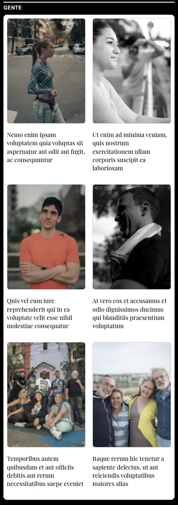](./docs/formatos/retratos-mobile.webp) | [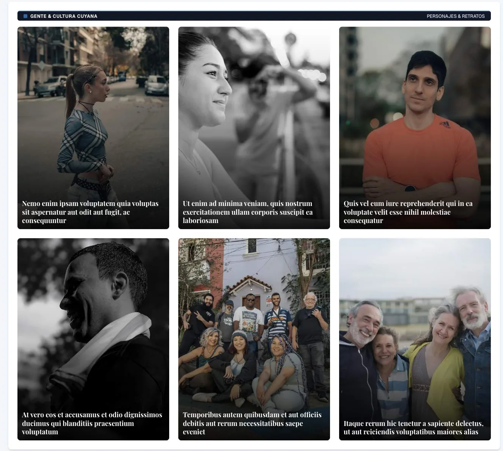](./docs/formatos/retratos-desktop.webp) |

- **Cupos y campos:** título y subtítulo de sección, seis perfiles con foto **vertical 3:4**, título y texto alternativo. La imagen vertical es parte distintiva del formato; no sustituirla por una miniatura horizontal agrandada.
- **Fuente actual:** textos de muestra y fotos editoriales Pexels.
- **Responsive e interacción:** grilla 2×3 en mobile, 3×2 en desktop. En mobile el título va debajo de cada foto; en desktop se superpone sobre un degradado. El hover es visual en dispositivos con puntero fino.
- **Uso editorial:** «Gente» para perfiles culturales. Otra instancia podría llamarse «Protagonistas de la Vendimia» con seis retratos propios.

#### Firmas · `firmas`

**Capturas de `/` (414 px y 1440 px):**

| Mobile | Desktop |
|---|---|
| [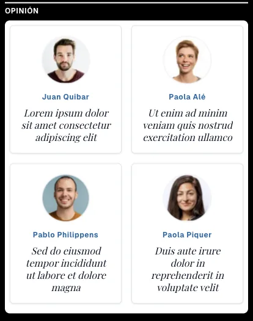](./docs/formatos/firmas-mobile.webp) | [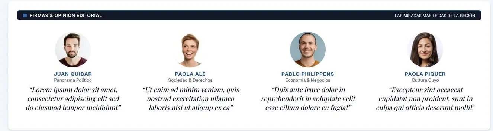](./docs/formatos/firmas-desktop.webp) |

- **Cupos y campos:** cuatro columnas con autor, avatar, título de la pieza y posible rúbrica o tema breve. El título general del bloque es configurable.
- **Fuente actual:** cuatro autores, avatares y copys de muestra locales.
- **Responsive e interacción:** 2×2 en mobile y cuatro columnas en desktop. El tratamiento es de tarjeta centrada con retrato circular y titular en itálica. Hover visual; la maqueta no asigna acción real a las cards.
- **Uso editorial:** «Opinión» con cuatro firmas de la edición; otra instancia podría reunir especialistas sobre una elección.

#### Panel deportivo · `panel-deportivo`

**Capturas de `/` (414 px y 1440 px):**

| Mobile | Desktop |
|---|---|
| [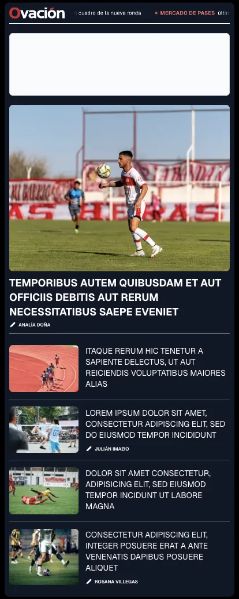](./docs/formatos/panel-deportivo-mobile.webp) | [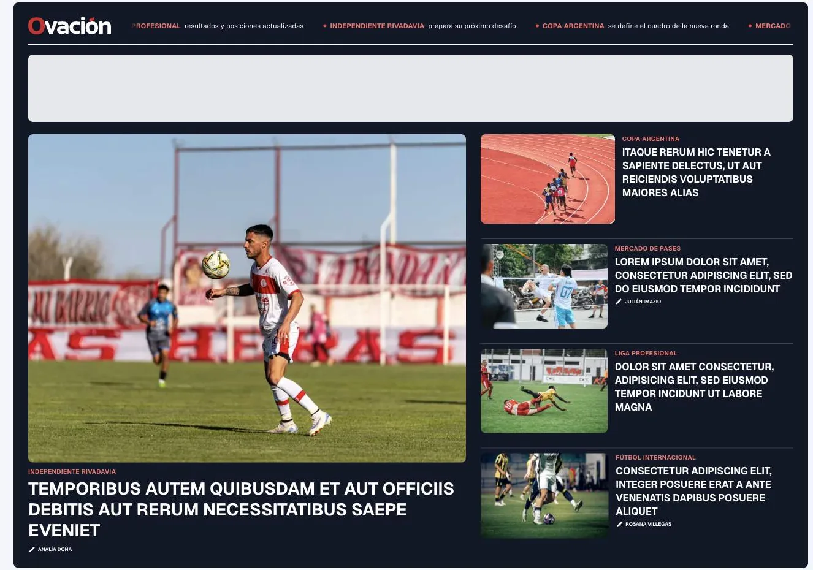](./docs/formatos/panel-deportivo-desktop.webp) |

- **Cupos y campos:** marca o título del bloque, una agenda/fixture, una nota principal con foto 4:3 y cuatro notas secundarias con foto 3:2, además de una cinta breve de novedades. La principal lleva título y firma, sin bajada en el diseño aprobado.
- **Fuente actual:** agenda general de DataFactory, fotos deportivas de muestra y textos locales.
- **Responsive e interacción:** panel oscuro en ambos anchos; mobile apila agenda, principal y listado; desktop alinea principal y cuatro secundarias. El ticker se mueve salvo preferencia de movimiento reducido. El widget conserva la interacción que provea DataFactory.
- **Uso editorial:** «Ovación» para actividad deportiva regional. Una segunda instancia, si se necesitara, elegiría sus propias noticias y fuente de agenda.

#### Últimas noticias · `ultimas-noticias`

**Capturas de `/` (414 px y 1440 px):**

| Mobile | Desktop |
|---|---|
| [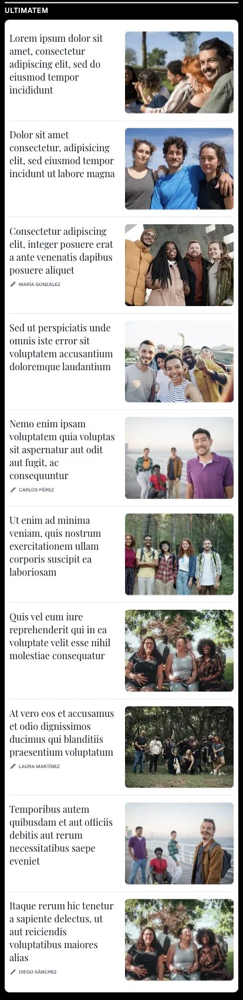](./docs/formatos/ultimas-noticias-mobile.webp) | [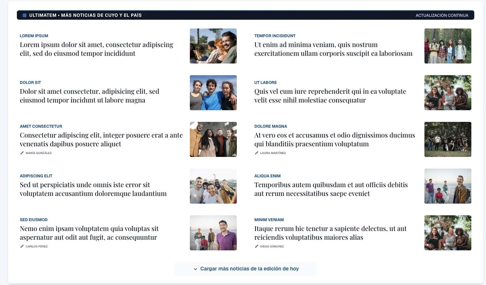](./docs/formatos/ultimas-noticias-desktop.webp) |

- **Cupos y campos:** diez noticias ordenadas, cada una con foto horizontal, titular y posible categoría y firma; título y leyenda del bloque.
- **Fuente actual:** fotos Pexels y titulares de muestra.
- **Responsive e interacción:** lista vertical de diez en mobile, dos columnas de cinco en desktop. «Cargar más noticias» es **solo visual** en la maqueta: no pagina ni agrega elementos. El hover tampoco abre una nota aquí; en producción esas acciones requieren definición funcional explícita.
- **Uso editorial:** un cierre de portada con diez lecturas recientes de Cuyo y el país.

#### Videos MAM · `videos-mam`

**Capturas de `/` (414 px y 1440 px):**

| Mobile | Desktop |
|---|---|
| [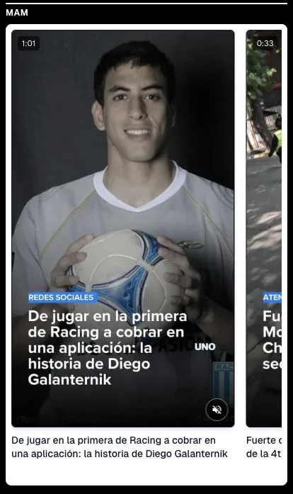](./docs/formatos/videos-mam-mobile.webp) | [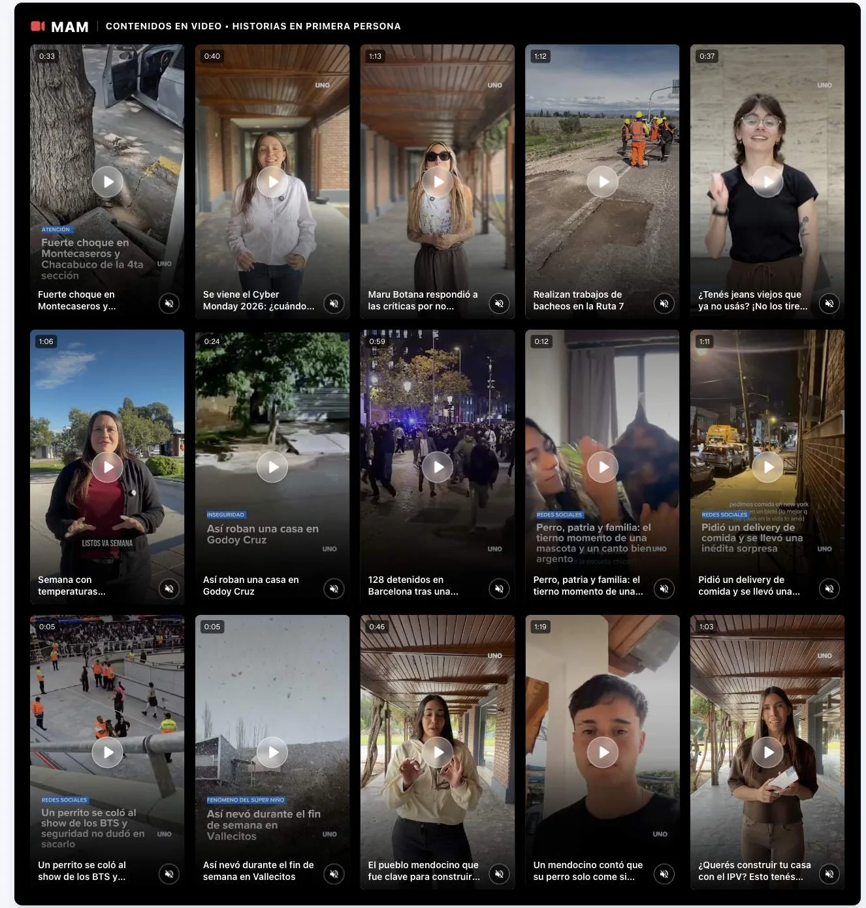](./docs/formatos/videos-mam-desktop.webp) |

- **Cupos y campos:** fuente/playlist de MAM y piezas con ID, URL de video, título, miniatura, duración y enlace a nota cuando exista. La playlist puede traer más piezas; **quince previews** ocupan la grilla desktop aprobada.
- **Fuente actual:** playlist de la API pública de MAM, ordenada según su propio orden. Si no trae piezas válidas, el módulo desaparece.
- **Responsive e interacción:** carrusel horizontal de piezas verticales 9:16 en mobile; grilla fija 5×3 en desktop. La tarjeta abre modal de video vertical con avance/retroceso, pausa, progreso y control de sonido. En desktop no se reproduce inline en la grilla.
- **Uso editorial:** una playlist de historias en primera persona curada para la portada.

#### Videos Shorts · `videos-shorts`

**Capturas de `/` (414 px y 1440 px):**

| Mobile | Desktop |
|---|---|
| [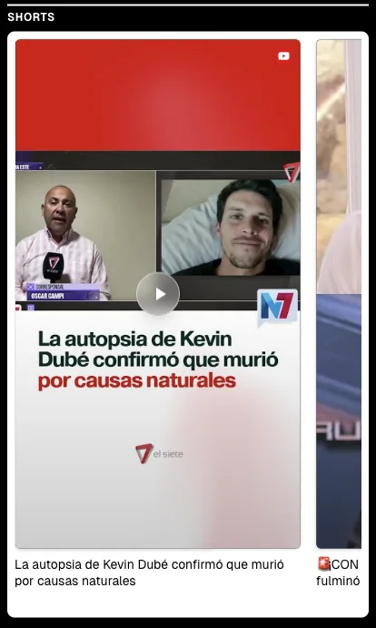](./docs/formatos/videos-shorts-mobile.webp) | [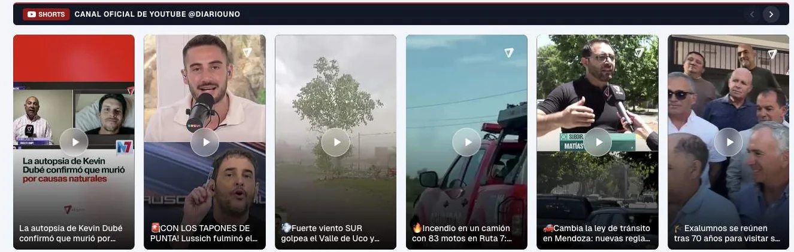](./docs/formatos/videos-shorts-desktop.webp) |

- **Cupos y campos:** fuente/playlist de YouTube y hasta doce piezas con ID, título y miniatura. La vista desktop muestra seis piezas simultáneas; no implica recortar el feed a seis.
- **Fuente actual:** playlist del canal de YouTube mediante API; sin clave o respuesta válida, se omite el módulo.
- **Responsive e interacción:** carrusel de tarjetas 9:16 en ambos anchos, con seis visibles y navegación anterior/siguiente en desktop. El feed usa miniaturas, sin iframes de reproducción. Al abrir una pieza se monta el reproductor en modal vertical, con pausa, progreso y sonido; la reproducción depende de YouTube.
- **Uso editorial:** selección de Shorts recientes del canal para la portada.

#### Videos Branded · `videos-branded`

**Capturas de `/` (414 px y 1440 px):**

| Mobile | Desktop |
|---|---|
| [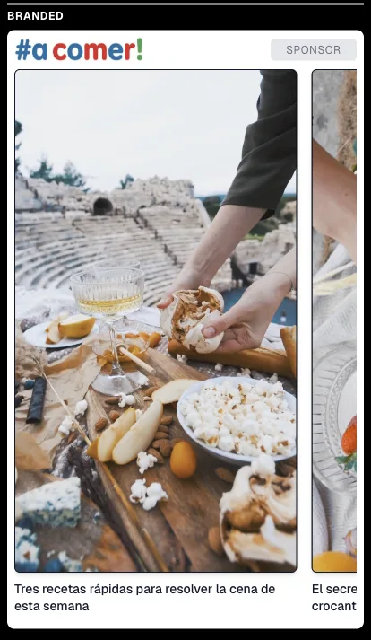](./docs/formatos/videos-branded-mobile.webp) | [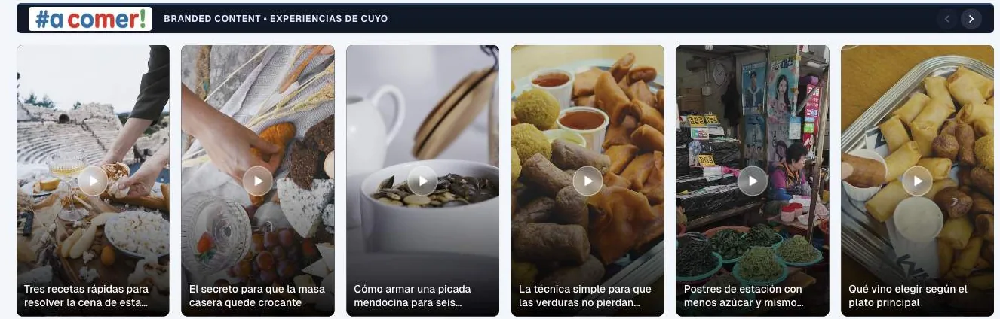](./docs/formatos/videos-branded-desktop.webp) |

- **Cupos y campos:** identidad comercial (nombre, logo, categoría, marca de sponsor) y hasta diez videos verticales con ID, URL, miniatura y copy. Seis piezas son visibles simultáneamente en desktop.
- **Fuente actual:** Pexels aporta videos de muestra; la vertical comercial local aporta la marca y los textos. La futura instancia comercial necesita selección y derechos propios, sin heredar la fuente de muestra.
- **Responsive e interacción:** carrusel 9:16 en ambos anchos, navegación desktop de seis piezas visibles. Abre el modal vertical compartido con pausa y progreso; el material actual es mudo y no ofrece control de sonido.
- **Uso editorial:** una vertical gastronómica patrocinada; otra campaña sería otra instancia con piezas y marca propias.

#### Participación y análisis · `participacion-analisis`

**Capturas de `/` (414 px y 1440 px):**

| Mobile | Desktop |
|---|---|
| [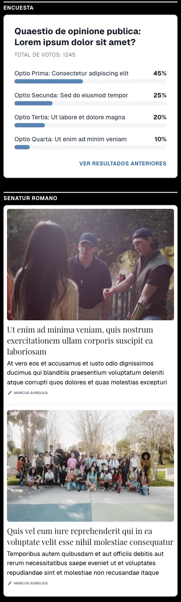](./docs/formatos/participacion-analisis-mobile.webp) | [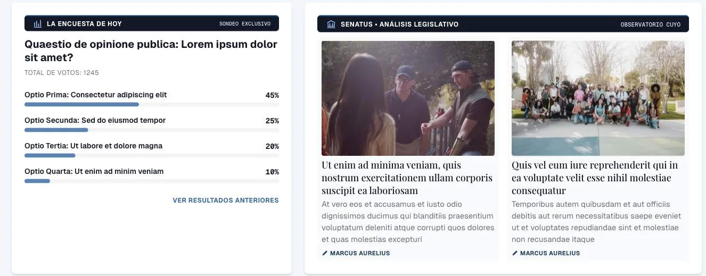](./docs/formatos/participacion-analisis-desktop.webp) |

- **Cupos y campos:** una encuesta con pregunta, **cuatro** opciones, porcentajes y total de votos; dos piezas de análisis Senatus, una con video y otra con imagen, cada una con título y bajada. Ambas mitades pertenecen a la misma instancia compuesta.
- **Fuente actual:** encuesta y copys de muestra; Senatus combina video y foto de muestra.
- **Responsive e interacción:** mobile apila encuesta y dos notas de Senatus; desktop ubica encuesta y Senatus en una fila de dos columnas. Los porcentajes y «Ver resultados anteriores» son visuales hoy, sin votación ni historial persistente. El video de Senatus usa reproducción automática al entrar en vista, según las reglas del componente.
- **Uso editorial:** sondeo del día junto a dos análisis que profundizan el tema. Al mover el bloque, encuesta y Senatus se mueven juntos en ese orden.

#### Transmisiones y anuncio · `transmisiones-anuncio`

**Capturas de `/` (414 px y 1440 px):**

| Mobile | Desktop |
|---|---|
| [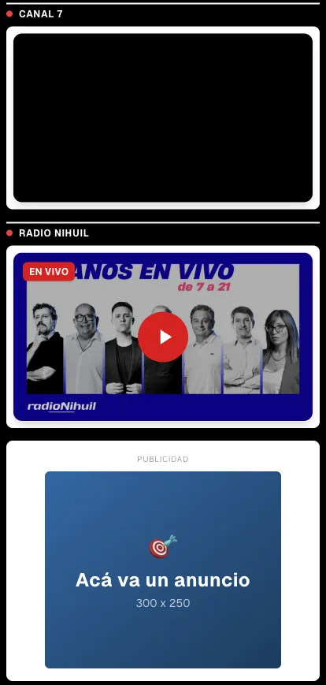](./docs/formatos/transmisiones-anuncio-mobile.webp) | [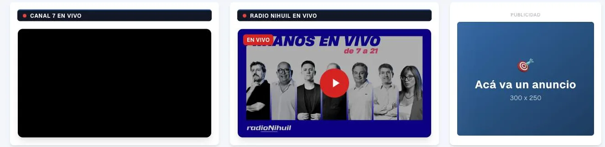](./docs/formatos/transmisiones-anuncio-desktop.webp) |

- **Cupos y campos:** dos fuentes de transmisión con identidad, título, señal y estado; una creatividad publicitaria 300×250. Son tres posiciones internas fijas.
- **Fuente actual:** Canal 7 y Radio Nihuil en sus reproductores de muestra/integración; anuncio de maqueta independiente de las señales.
- **Responsive e interacción:** mobile apila las dos transmisiones y luego el anuncio; desktop las ubica en una fila de tres columnas de igual altura, con 332 px reservados para la publicidad. Los controles de reproducción pertenecen a cada señal. Los puntos «en vivo» respetan movimiento reducido.
- **Uso editorial:** bloque de transmisiones en directo con un patrocinio asociado. Otra instancia usaría señales y creatividad propias.

#### Gráfico + chat · `grafico-chat`

**Capturas de `/` (414 px y 1440 px):**

| Mobile | Desktop |
|---|---|
| [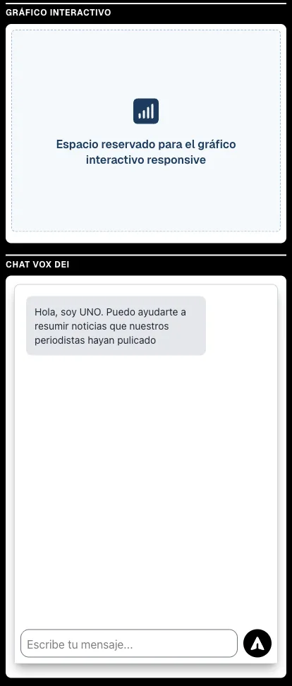](./docs/formatos/grafico-chat-mobile.webp) | [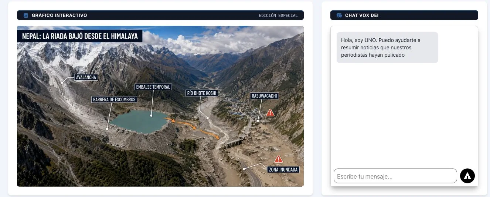](./docs/formatos/grafico-chat-desktop.webp) |

- **Cupos y campos:** un gráfico interactivo con tema, título, contenido y configuración responsive; un chat con identidad y fuente/configuración de asistencia. Son dos posiciones internas fijas de una misma instancia: primero el gráfico, después el chat.
- **Fuente actual:** en mobile hay un espacio reservado para el futuro gráfico responsive. En desktop, `video_nepal.mp4` en loop es **solo una muestra temporal** porque todavía no se dispone del HTML interactivo para insertar. El chat conserva su interfaz de muestra.
- **Responsive e interacción:** mobile apila la reserva del gráfico y el chat debajo. Desktop alinea la muestra audiovisual y el chat en dos columnas de igual altura; cuando llegue el gráfico real reemplazará el video, sin cambiar la identidad del formato. El chat conserva sus controles. Sudoku ya no pertenece a este bloque.
- **Uso editorial:** un gráfico de contexto sobre un tema especial acompañado por el asistente. El editor mueve este conjunto como una unidad, con su orden interno fijo.

#### Publicidad adaptable · `publicidad-adaptable`

**Capturas de `/` (414 px y 1440 px):**

| Mobile | Desktop |
|---|---|
| [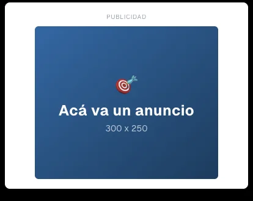](./docs/formatos/publicidad-adaptable-mobile.webp) | [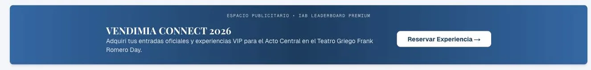](./docs/formatos/publicidad-adaptable-desktop.webp) |

- **Cupos y campos:** una creatividad por contexto, con identificador de campaña, etiqueta publicitaria, recurso visual o HTML autorizado por el futuro proveedor, destino y tamaños. No se copian campañas al duplicar instancias. El anuncio 300×250 dentro de «Transmisiones y anuncio» y el 300×600 de la cabecera son **cupos internos** de esos compuestos, no este bloque independiente.
- **Fuente actual:** anuncio independiente de muestra: rectángulo 300×250 en mobile y pieza tipo leaderboard «VENDIMIA CONNECT 2026» en desktop.
- **Responsive e interacción:** se adapta al ancho sin ampliar una imagen chica por encima de su resolución útil. La maqueta muestra llamada a la acción visual; el destino real queda por definir con la campaña.
- **Uso editorial:** insertar un anuncio autónomo entre Ovación y Sociedad, o sumar otro en otra posición de la home.

#### Espacio de juegos · `espacio-juegos`

**Capturas de `/` (414 px y 1440 px):**

| Mobile | Desktop |
|---|---|
| [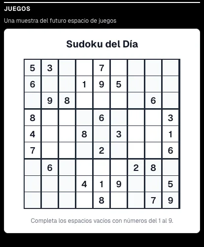](./docs/formatos/espacio-juegos-mobile.webp) | [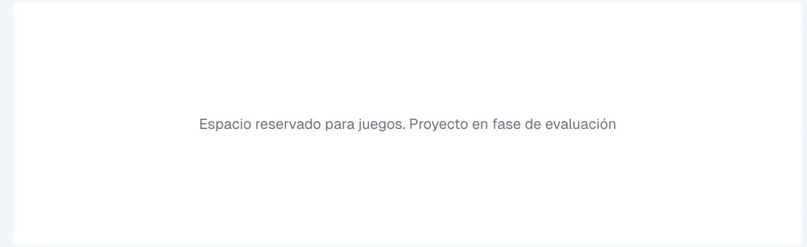](./docs/formatos/espacio-juegos-desktop.webp) |

- **Cupos y campos:** un espacio para juegos con identidad y selección de una experiencia de muestra o su futura fuente. La instancia actual ofrece Sudoku en mobile; en desktop conserva una reserva de ancho completo mientras se evalúa el producto.
- **Fuente actual:** tablero Sudoku local y texto «Espacio reservado para juegos. Proyecto en fase de evaluación». Ambos representan el **mismo espacio editorial**, no dos formatos separados.
- **Responsive e interacción:** mobile muestra Sudoku editable debajo de Crimen; desktop muestra la reserva blanca de 400 px sin controles. El prototipo no incluye generador, validación ni reinicio del Sudoku.
- **Uso editorial:** una sección de juegos que puede presentar una muestra en mobile mientras su experiencia desktop sigue en evaluación. El editor puede ubicarla independientemente de «Gráfico + chat» y repetirla con otra identidad y juego propios.

## Comprobación con la maqueta

El orden observado en `/` es: Cobertura con video → Cabecera editorial → Videos MAM → Principal + cuatro (Política) → Videos Shorts → Firmas → Videos Branded → Participación y análisis → Panel deportivo → Publicidad adaptable → Principal + cuatro (Sociedad) → Transmisiones y anuncio → Gráfico + chat → Retratos → Principal + cuatro (Crimen) → Espacio de juegos → Últimas noticias. La cabecera mantiene su composición interna propia.

**Política y Gente no son nombres de formato:** Política, Sociedad y Crimen usan `principal-cuatro`; Gente usa `retratos`. Los IDs del catálogo se conservarán aunque cambien los títulos visibles o se sumen secciones. Para el estado y los diseños pendientes, ver [PROGRESS.md](./PROGRESS.md).
